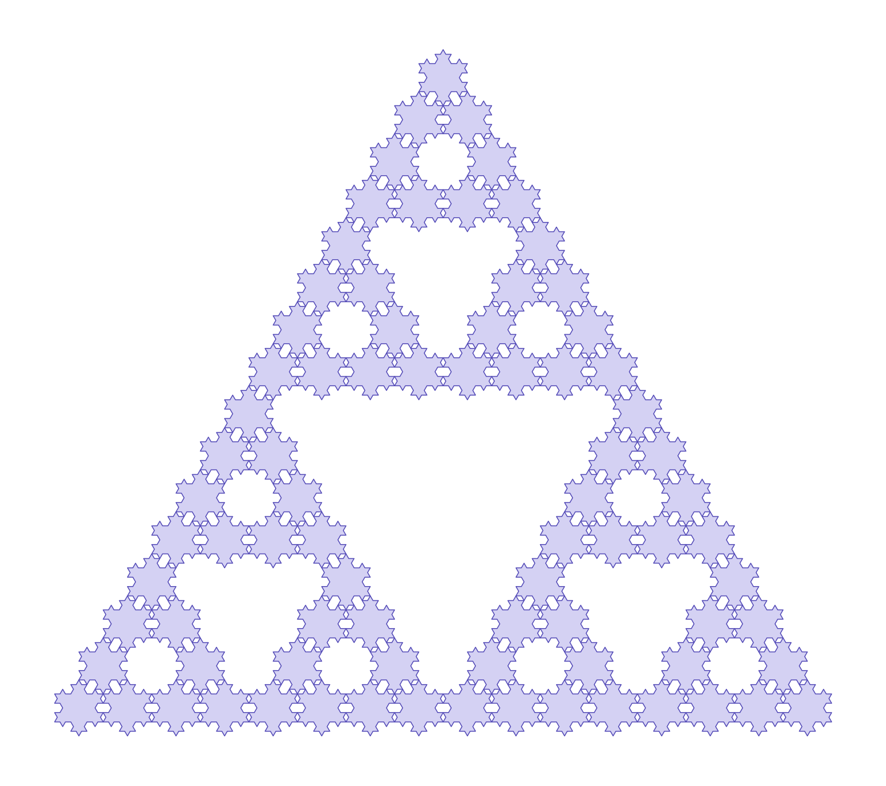

# Koch–Sierpiński

A Sierpiński triangle whose smallest triangles are replaced by Koch
snowflakes: one fractal nested inside the algorithm of another.



## Idea

The classic Sierpiński triangle is built by repeatedly splitting a
triangle into three smaller copies and leaving the middle one empty.
Normally the recursion ends in a plain triangle. Here it ends in a
Koch snowflake, which is itself generated recursively.

There are two independent recursion depths:

- $n$: depth of the Sierpiński recursion
- $k$: depth of the Koch recursion

## Why it fits together

A Koch bump on a triangle of side $L$ has height $\frac{\sqrt{3}}{6}L$,
which is exactly the inradius of the triangular hole next to it. The tips
of the three neighbouring snowflakes therefore meet in the centre of each
hole, and nothing overlaps.

## Some numbers

For a start triangle of side $L$:

- Number of snowflakes: $3^n$
- Segments per snowflake: $3 \cdot 4^k$
- Total boundary length:

$$
\ell = 3L \left(\tfrac{3}{2}\right)^{n} \left(\tfrac{4}{3}\right)^{k}
$$

- Area of one snowflake as $k \to \infty$: $\tfrac{8}{5}$ of its start triangle

## Usage

```bash
pip install matplotlib numpy
python plot.py          # draws the fractal
python dimensions.py    # estimates the dimension
```

Change `n` and `k` at the bottom of each script. Large values such as
`n=5, k=4` produce several hundred thousand segments and take a moment.

## Implementation

- `fractal.py`
  - `koch(a, b, s, tiefe)` builds a Koch curve between two points as a list
    of points. `s = ±1` chooses the side the bump points to.
  - `schneeflocke(A, B, C, k)` joins three Koch curves into a snowflake and
    makes the bumps point outward.
  - `sierpinski(A, B, C, n, k)` splits the triangle recursively and returns
    the snowflake polygons.
- `plot.py` draws the polygons with matplotlib.
- `dimensions.py` estimates the box-counting dimension.

## Dimension

### Hausdorff dimension

Cover a set $F$ with sets $U_i$ of diameter at most $\delta$, add up
$(\operatorname{diam} U_i)^s$, take the
